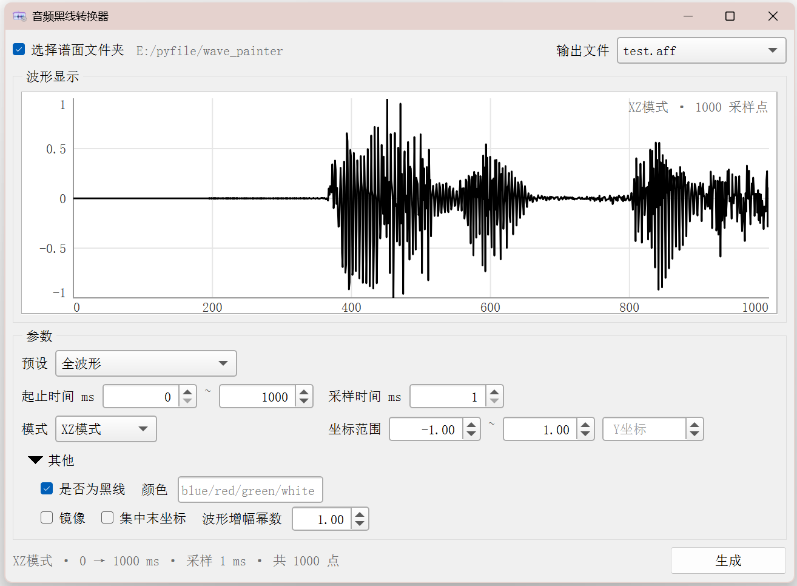

# 音频黑线转换器 | Wave Painter

一个可以将将音频文件转为 `*.aff` 文件中的 arc 的小工具。  
支持 OGG / MP3 / WAV 格式   
需要预先安装 ffmpeg

## 使用技巧

- 该工具的预览波形功能会将所有采样点绘制到屏幕上，在预览时最佳实践为先将采样时间调至合适范围，再扩大时间范围以保证性能
- 将光标放在相应的输入框上可以看到相关提示
- 自由通过预设与所支持的各种参数的组合来 DIY 出你想要的任何波形，例如：
    高保真波形：全波形 0ms / 采样时间 5ms
    语音式高保真波形：对称波形 0ms / 采样时间 5ms
    语音式线式波形：对称波形 0ms / 采样时间 10ms

## 需要注意的事
该工具会自动读取谱面文件夹中的 `base.ogg` `base.mp3` `base.wav`，这是为了方便用户而设计的。如果你需要自定义音频，需要先新建工作区进行
 
该工具会将大量 arc 生成在你选中的输出文件中。工具会新建一个 `TimingGroup` 来存储所有的波形 arc ，如果你对生成的效果不满意，可以直接删除对应的组（在加载不做修改后为最后一个组）；或者将备份 `*.aff.bak` 删去 `.bak` 后缀来回档谱面

该工具会选择音频的其中一个声道作为波形文件源（通常为左声道）。如果你的目标音源有一定特殊性，请先进行处理

目前暂不支持读取在 songlist 中使用 `audioOverride` 而设置的差分音频（如 `3.ogg` ），至少这是后续的开发方向

## 协议与声明
该工具遵循 MIT License 协议   
该项目为 Begloon 的个人项目，仅对 `.aff` 文件的处理相关，与其他游戏无关联 