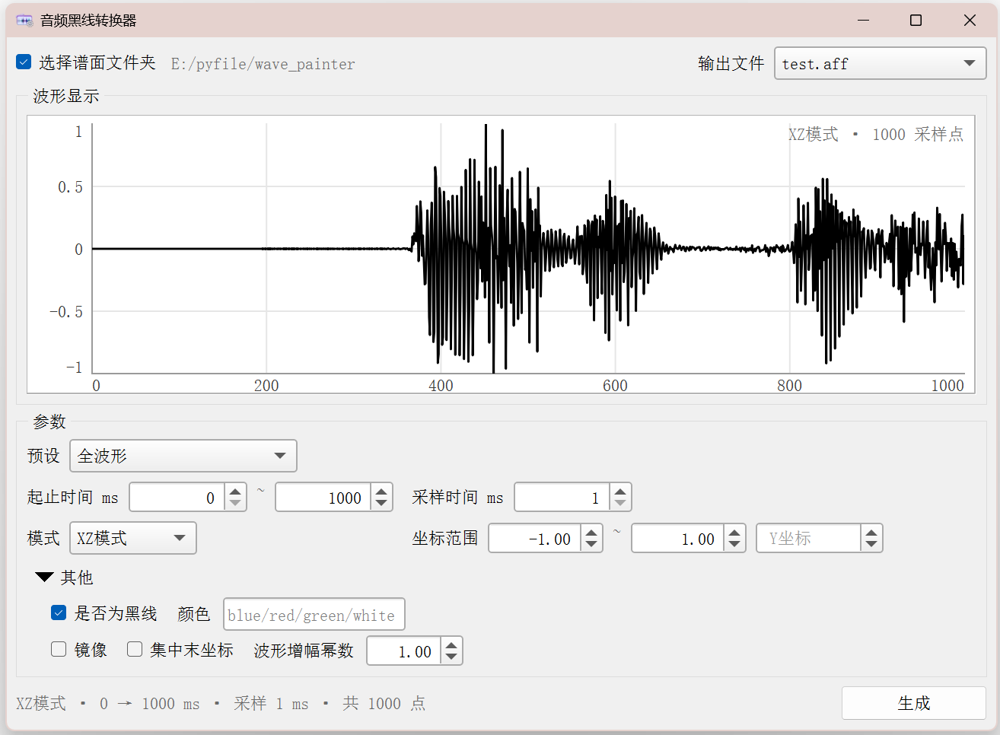

# 音频黑线转换器 | Wave Painter

一个可以将音频文件转为 `*.aff` 文件中的 arc 的小工具。  
支持 OGG / MP3 / WAV 格式 

> [!IMPORTANT]  
> 需预先安装 ffmpeg （工具会提示安装方法）
> 目前仅编译了 Windows 的可运行文件，其他系统请自行用 Pyinstaller 进行编译


## 使用技巧


- 该工具的预览波形功能会将所有采样点绘制到屏幕上，在预览时最佳实践为先将采样时间调至合适范围，再扩大时间范围以保证性能
- 将光标放在相应的输入框上可以看到相关提示
- 自由通过预设与所支持的各种参数的组合来 DIY 出你想要的任何波形，例如：

```    
    高保真波形：全波形 0ms / 采样时间 5ms      
    语音式高保真波形：对称波形 0ms / 采样时间 5ms  
    语音式线式波形：对称波形 0ms / 采样时间 10ms / 集中末坐标  
```

## 需要注意的事
该工具会自动读取谱面文件夹中的 `base.ogg` `base.mp3` `base.wav`，这是为了方便用户而设计的。如果你需要自定义音频，需要先新建工作区进行
 
该工具会将大量 arc 生成在你选中的输出文件中。工具会新建一个 `TimingGroup` 来存储所有的波形 arc ，如果你对生成的效果不满意，可以直接删除对应的组（在加载不做修改后为最后一个组）；或者将备份 `*.aff.bak` 删去 `.bak` 后缀来回档谱面

该工具会选择音频的其中一个声道作为波形文件源（通常为左声道）。如果你的目标音源有一定特殊性，请先进行处理

目前暂不支持读取在 songlist 中使用 `audioOverride` 而设置的差分音频（如 `3.ogg` ），至少这是后续的开发方向

## 构建与打包

项目使用 [PyInstaller](https://pyinstaller.org/) 打包，仓库里只有一份正式配置
[`build.spec`](build.spec)，Windows / macOS / Linux 都由它产出：

```cmd
py -3.12 -m pip install -r requirements.txt
python -m PyInstaller --noconfirm --clean build.spec
```

- 环境要求：Python 3.12（`requirements.txt` 已固定依赖版本，与 v1.0.0 发布产物一致）。
- 产物在 `dist/` 下：Windows 为 `wave_painter.exe`（单文件），macOS 为 `.app`，Linux 为可执行文件。
- 想固定产物文件名可设 `WP_EXE_NAME`，例如 `set WP_EXE_NAME=wave_painter`。
- 想把 `tools/ffmpeg/<平台>/` 下的 `ffmpeg`、`ffprobe` 一起打进包，把文件放进去即可，`build.spec` 会自动收集。

### 调试版（排查启动失败）

Windows 上打包一个带控制台、会打印 Python 异常的调试版：

```cmd
set WP_CONSOLE=1
set WP_EXE_NAME=wave_painter
python -m PyInstaller --noconfirm --clean build.spec
```

产物为 `dist\wave_painter_debug.exe`。在 cmd.exe 里运行它，Python 层的报错会直接显示在
控制台；也可以加 `WP_DEBUG=1` 打开 PyInstaller 的调试输出。

### 日志

程序启动时会把自己初始化过程的记录写到日志文件，Windows 在：

```
%LOCALAPPDATA%\wave_painter\run.log
```

macOS 为 `~/Library/Logs/wave_painter/run.log`，Linux 为 `~/.local/state/wave_painter/run.log`。
如果程序“点了没反应 / 一闪而过”，先看这个日志。源码运行（`py -3 waveform_ui.py`）也会写同一份日志

### 发布与校验

推送 `v*` 或纯数字 tag（如 `v1.1.0`、`2026.10.29`）会触发 GitHub Actions 构建
Windows / macOS（Apple Silicon、Intel）/ Linux 产物并创建 Release，附带 `SHA256SUMS.txt`  
校验下载文件：

```cmd
certutil -hashfile wave_painter.exe SHA256
```

## 启动失败排查

1. 先核对文件哈希与 Release 里的 `SHA256SUMS.txt` 是否一致，不一致说明下载不完整或被改写
2. 按上面「调试版」打包，在 cmd.exe 中运行 `wave_painter_debug.exe`，查看 Python 异常
3. 查看日志 `%LOCALAPPDATA%\wave_painter\run.log`
4. 若提示缺少 `ffmpeg`，安装 ffmpeg 并加入 `PATH`，或放到程序同目录的 `tools/ffmpeg/<平台>/`
5. 把调试版控制台输出 + `run.log` 一起贴到 issue 里

> 打包产物没有数字签名，个别杀毒软件会对 PyInstaller 单文件包误报，或拦截它解压到
> `%TEMP%\_MEIxxxx` 的行为。被拦截时请放行，或先用调试版确认是不是程序本身的问题

## 协议与声明
该工具遵循 MIT License 协议   
该项目为 Begloon 的个人项目，仅对 `.aff` 文件的处理相关，与其他游戏无关联 
